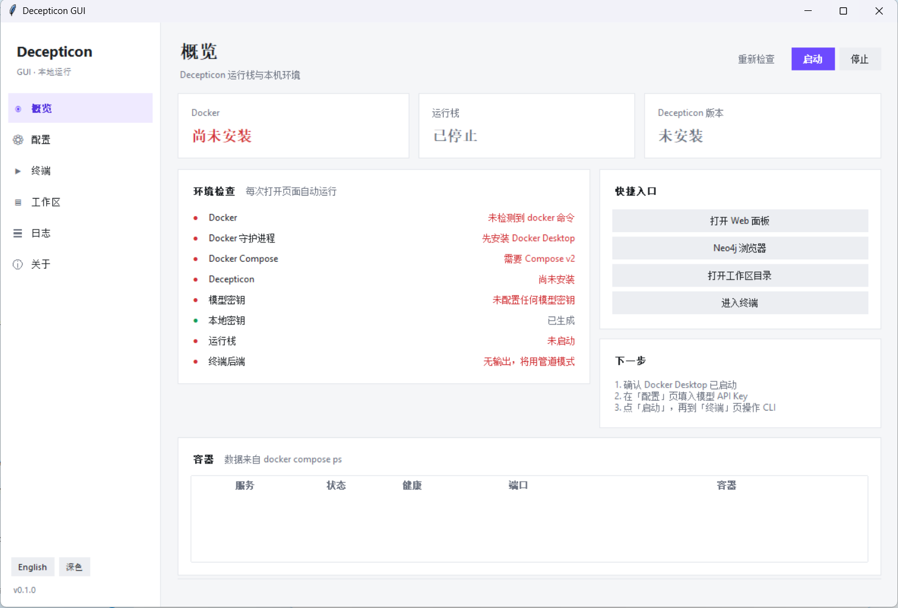
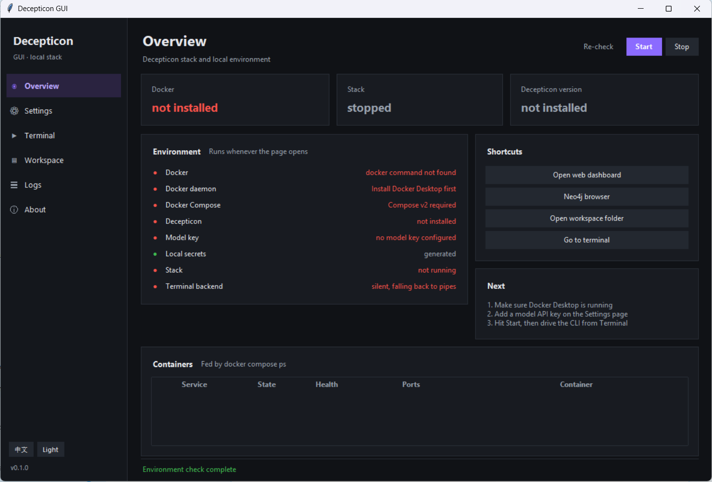

# Decepticon GUI

给 [Decepticon](https://github.com/PurpleAILAB/Decepticon) 套一个 Windows 桌面壳。装环境、填 Key、拉容器、开 CLI，都在一个窗口里点完。

不含 Decepticon 源码，也不改它的安装方式 —— 调用你本机已经装好的 Decepticon（默认在 `%USERPROFILE%\.decepticon`）和 Docker Desktop。




## 能干什么

- **中英双语**：界面跟随系统语言，中文系统用中文，其他回退英文；侧栏一键切换，不用重启
- **深浅双色**：首次启动跟随 Windows 应用主题（浅色/深色），侧栏一键切换，正在跑的终端不会被打断
- **环境自检**：Docker、Compose、Decepticon 装没装、模型密钥配没配、栈跑没跑，缺什么直接写出来
- **配置**：选服务商、填 API Key、挑模型档位（eco / max / test）、改端口，直接写 `.env`；保存时把模板里的默认密码换成随机值
- **运行栈**：启动、停止、看每个容器的状态；Web 面板没跑会自动拉起来
- **终端**：ConPTY 内嵌官方 CLI，颜色和 TUI 正常，Ctrl+C 可用。ConPTY 不可用时自动退回管道模式，状态栏会写明当前是哪种
- **工作区 / 日志**：浏览 `workspace` 里的文件，跟 `docker compose logs`
- **关于**：许可证、上游归属、免责声明

## 环境要求

- Windows 10 1809 及以上 / Windows 11
- Docker Desktop，WSL2 后端
- Python 3.10+，且带 tkinter（python.org 的安装包默认带，Microsoft Store 版不带）

## 发行版

仓库的 GitHub Actions 在推 tag `v*` 时自动打包，产物是 `DecepticonGUI-<version>-win64.zip`（约 11 MB）。解压后双击 `DecepticonGUI.exe` 就能用，不需要装 Python。

注意：exe 里只有界面。Decepticon 本体和 Docker Desktop 仍需你自行安装，程序会在「概览」页告诉你还差什么。

## 跑起来

```bat
git clone https://github.com/<your-name>/decepticon-gui.git
cd decepticon-gui
python run.py
```

第一次使用的顺序：

1. 「配置」页点「安装 / 更新 Decepticon」，走 decepticon.red 官方脚本，装完点「重载」
2. 选服务商、填 API Key、保存
3. 「概览」页点「启动」，等容器健康
4. 「终端」页点「启动 CLI」

指定起始页：`python run.py --page setup`

## 打包发行版

```bat
powershell -ExecutionPolicy Bypass -File packaging\build.ps1
```

脚本会找一个带 tkinter 的 Python（3.11/3.12/3.13 都行，没装 PyInstaller 会自动装），产出：

```
dist\DecepticonGUI\                     onedir，双击 DecepticonGUI.exe 直接跑
dist\DecepticonGUI-0.1.0-win64.zip      发布用压缩包，已带 LICENSE / NOTICE
```

指定解释器或跳过压缩：

```bat
powershell -ExecutionPolicy Bypass -File packaging\build.ps1 -Python C:\Python312\python.exe -SkipZip
```

图标在 `packaging/icon.ico`，需要重画就改 `packaging/make_icon.py` 再跑一次。

仓库带了 GitHub Actions（`.github/workflows/build.yml`）：推 tag `v*` 时自动在 windows-latest 上打包，并把 zip 挂到 Release。

## 已知限制

- 终端没有回滚缓冲，长输出请到「日志」页看
- 中文按两格宽渲染，某些等宽字体下会有一两个像素的错位
- 只做了 Windows。Linux/macOS 能起界面，但终端只能是管道模式
- 容器操作依赖 `docker compose` 的 JSON 输出格式，Compose v2.21 以下可能读不到状态

打包版启动崩溃会写 `%APPDATA%\DecepticonGUI\crash.log`；排查环境可用 `DecepticonGUI.exe --dump-env env.txt`，把调色板、Tcl 版本、路径写到文本里。

## English

A Windows desktop front end for [Decepticon](https://github.com/PurpleAILAB/Decepticon). It wraps installation, configuration, the Compose stack and the CLI into one window.

No upstream source is bundled; it drives the Decepticon you installed yourself (`%USERPROFILE%\.decepticon`) and Docker Desktop.

- **Bilingual UI** — follows the system language, falls back to English; switch from the sidebar, no restart
- **Light and dark themes** — follows the Windows app theme on first run; switching keeps a running terminal session alive
- **Environment checks** — Docker, Compose, installation, model keys, stack health
- **Settings** — provider, API key, model profile, ports, written straight to `.env` with random secrets
- **Stack control** — start/stop, container states, one-click web dashboard
- **Embedded terminal** — ConPTY with a pipe fallback (reported in the status bar)
- **Workspace and logs** — browse engagement files, tail `docker compose logs`

Requirements: Windows 10 1809+, Docker Desktop (WSL2), Python 3.10+ with tkinter.

```bat
python run.py
```

## 授权

本项目使用 [Apache License 2.0](LICENSE)。

上游 Decepticon 同样使用 Apache-2.0，版权归 PurpleAILAB 及其贡献者所有。本仓库不包含其源代码，只通过命令行和 Docker 调用它。署名与修改说明见 [NOTICE](NOTICE)。

本项目与 PurpleAILAB 无隶属关系，也未获其背书。

## 免责声明

只在取得书面授权的系统或网络上使用。未经授权访问计算机系统属于违法行为，责任自负。
